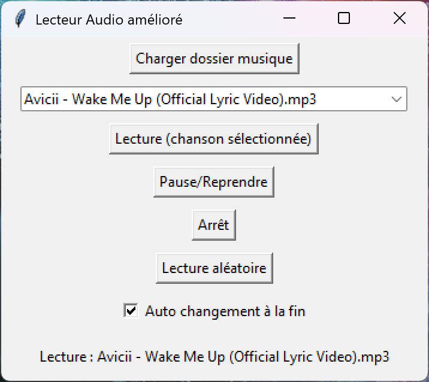

<div align="center">
  <h1>🎧 Music_Player</h1>
  
  <h4>⚠️ This repository has been archived and is no longer maintained. ⚠️</h4>
</div>

## 🇬🇧 English Version

A lightweight desktop music player built with **Python**, using **tkinter** for the interface and **pygame** for audio playback.

---

### ✨ Features

- 🔍 Browse and select `.mp3` files from a directory  
- ▶️ Play, pause, and stop audio  
- ⏭️ Skip or restart tracks  
- 🔉 Adjust volume  
- 💻 Clean graphical interface with tkinter  
- ⚙️ Minimal dependencies, cross-platform

---

### 🚀 Installation

1. Clone the repository:
   ```bash
   git clone https://github.com/Erazor48/Music_Player.git
   cd Music_Player
   ```

2. Install required dependencies:
   ```bash
   pip install pygame
   ```

---

### ▶️ Usage

Run the following command:
```bash
python UI.py
```
Select a folder containing your `.mp3` files and enjoy listening 🎶

---

### 🛠️ Tech Stack

- **Python**
- **tkinter** – GUI
- **pygame** – Audio playback

---

### 📌 Roadmap

- [ ] Playlist support  
- [ ] Support for additional formats (WAV, FLAC, etc.)  
- [ ] Enhanced UI and design  
- [ ] Keyboard shortcuts  
- [ ] Build as a standalone executable (via PyInstaller or cx_Freeze)

---

### 📄 License

MIT – See [LICENSE](LICENSE) for details.

---

## 🇫🇷 Version Française

Un lecteur de musique de bureau léger, développé en **Python**, utilisant **tkinter** pour l’interface graphique et **pygame** pour la lecture audio.

---

### ✨ Fonctionnalités

- 🔍 Parcours et sélection de fichiers `.mp3` depuis un dossier  
- ▶️ Lecture, pause et arrêt de la musique  
- ⏭️ Suivant/précédent ou redémarrage de la piste  
- 🔉 Réglage du volume  
- 💻 Interface propre et intuitive avec tkinter  
- ⚙️ Peu de dépendances, compatible multi-plateforme

---

### 🚀 Installation

1. Cloner le dépôt :
   ```bash
   git clone https://github.com/Erazor48/Music_Player.git
   cd Music_Player
   ```

2. Installer les dépendances nécessaires :
   ```bash
   pip install pygame
   ```

---

### ▶️ Utilisation

Lancez la commande suivante :
```bash
python UI.py
```
Sélectionnez un dossier contenant vos fichiers `.mp3` et profitez de votre musique 🎶

---

### 🛠️ Technologies utilisées

- **Python**
- **tkinter** – Interface graphique
- **pygame** – Lecture audio

---

### 📌 Feuille de route

- [ ] Support des playlists  
- [ ] Support d'autres formats (WAV, FLAC, etc.)  
- [ ] Amélioration de l’interface utilisateur  
- [ ] Raccourcis clavier  
- [ ] Création d’un exécutable standalone (avec PyInstaller ou cx_Freeze)

---

### 📄 Licence

MIT – Voir [LICENSE](LICENSE) pour plus de détails.